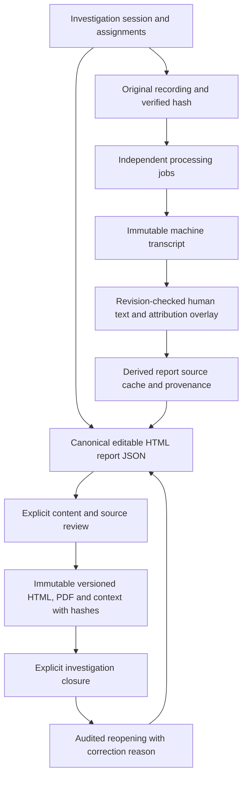

# Investigation workflow: field lineage and duplication matrix

Scope: every mapped field in investigation, identity, evidence, processing and reporting models; report JSON leaf fields are listed separately. Paths below are relative to `/api`; `{id}` denotes the existing investigation session, which remains the workflow boundary.

The source-to-matrix audit covers 19 tables, with no unlisted directly mapped columns in those tables. Shared UUID/timestamp fields are described below. This inventory check complements the API/workflow regression checks; it does not replace them.

Review can begin before issuance. Closure requires a current official version, completed processing and intact original audio. Issuance locks shared person/profile records until commit, verifies original audio hashes and renders PDF from the exact archived HTML. Final previews read the archived HTML rather than rebuilding historical wording or names from current registry facts.

## Canonical ownership and deliberate snapshots

| Repeated value | Canonical owner | Reuse / historical copy | Resolution |
|---|---|---|---|
| Current person name | person_identities.person_name, resolved through merges | Profile display mirrors the registry; subjects.subject_name retains the declared session value | Displays prefer the resolved canonical name; issued HTML/PDF and context never change |
| Person service / civil / document identifier | person_identifiers, scoped normalized identifier | Subject/profile fields describe session/service facts; source records keep provenance | Registry service attaches facts to existing UUID; investigator service numbers unique per force |
| Session title/date/location/time | investigation_sessions | Report defaults and explicit document overrides | Blank/untouched downstream facts populate from source; overrides remain in JSON with provenance |
| Statement biography | subjects.statement_details | HTML block.values and person_snapshot | Single session owner; document override is explicit and cannot write back to subject/evidence |
| Transcript wording/attribution | transcript_segments.original_text and original speaker/time | edited_text or attribution_parts is a reviewed overlay; QA cache/import snapshots derived | speech_parts chooses reviewed content, ORIGINAL mode chooses machine evidence |
| Workflow status | investigation_sessions.workflow_state | Processing jobs have their own status; old status remains a compatibility processing summary | Completion of a job cannot review or close an investigation |
| Report content | report_drafts.official_form.html_report | Generated HTML/PDF/context are frozen issued versions | Alternate draft header/Q&A editing columns and Word/M53 template tables removed |
| Renderer version | generated_reports.renderer_sha256 | Context stores exact renderer/catalogue/font digest | Review digest binds content, source facts and renderer bytes |

## Command and validation controls

| Frontend/API control | Persistence / validation | Downstream effect |
|---|---|---|
| expected_revision | Compare under row lock to session/segment revision; stale returns 409 | Stops lost session, text and attribution updates |
| recording_id on processing-token request | Existing recording UUID, same session, matching file metadata, no active attempt | Retries create another processing job while preserving the original recording/evidence owner |
| processing_summary / unresolved_processing_failures | Derived from jobs; successful retry resolves the latest failure for that recording, cancellation does not | Current workflow blockers distinguish unresolved failures from historical attempts |
| expected_token | SHA-256 of draft document and monotonic report revision; compare under draft/session lock | Stops stale report saves, including edits reverted to earlier wording, review, issuance and reopen |
| expected_source_token | Canonical source digest; compare during review | Upstream changes require renewed review and explicit acknowledgment |
| removed_participant_keys / removed_document_ids | Validate ownership; set removed_at, never infer from omission | Active lists exclude rows; original IDs and evidence remain |
| Workflow state + reason | Explicit allowed transition, revision, RBAC and audit event | reports.finalize required for reviewed/closed; active jobs/missing audio/current unissued or stale report block closure |
| Scan upload/removal | MIME/bytes/path validation; new UUID path; retain prior file metadata | Retained versions require the same session access and documents.view permission |
| Assignment roles | Exactly one LEAD; profile FK; no duplicate assignment | Lead default, permissions and official signature |
| Times/confidence | API validates ranges; database checks validate new and existing data | Bad ranges cannot enter report source selection |
| Cross-stage record IDs | Composite recording/session and job/recording/session database FKs | Cannot attach a transcript/job/speaker to another investigation |
| Review confirmation | Exact content + sources + renderer digest, actor/time | No content mutation can silently preserve a valid approval |

## Database field inventory

Each row names the actual column (not a newly invented alias). SQLAlchemy column declaration supplies type/nullability/default/FK validation; API schemas add length, enum and identifier validation. UUID/timestamps inherited from Base mixins apply to each model.

### AuditLog: `audit_logs`

Frontend: AuditPage. API: `/audit`. Consumer: Authenticated actor/time/action plus before/after/reason; historical record.

| Database column | Type / constraints | Owner / use |
|---|---|---|
| `audit_logs.user_id` | `UUID(as_uuid=True), ForeignKey('users.id', ondelete='SET NULL'), nullable=True, index=True` | Authenticated actor/time/action plus before/after/reason; historical record |
| `audit_logs.action` | `String(64), nullable=False, index=True` | Authenticated actor/time/action plus before/after/reason; historical record |
| `audit_logs.entity_type` | `String(64), nullable=True, index=True` | Authenticated actor/time/action plus before/after/reason; historical record |
| `audit_logs.entity_id` | `String(64), nullable=True, index=True` | Authenticated actor/time/action plus before/after/reason; historical record |
| `audit_logs.safe_metadata` | `JSONB, nullable=True` | Authenticated actor/time/action plus before/after/reason; historical record |
| `audit_logs.ip_address` | `String(64), nullable=True` | Authenticated actor/time/action plus before/after/reason; historical record |
| `audit_logs.created_at` | `DateTime(timezone=True), nullable=False, server_default=func.now(), index=True` | Authenticated actor/time/action plus before/after/reason; historical record |

### InvestigationSession: `investigation_sessions`

Frontend: InvestigationFormPage / InvestigationWorkflow. API: `/investigations; /{id}; /{id}/workflow`. Consumer: Session facts; lifecycle, report defaults and source digest.

| Database column | Type / constraints | Owner / use |
|---|---|---|
| `investigation_sessions.session_number` | `String(64), unique=True, nullable=False, index=True` | Session facts; lifecycle, report defaults and source digest |
| `investigation_sessions.revision` | `Integer, nullable=False, default=0, server_default='0'` | Server-owned identifier/provenance |
| `investigation_sessions.workflow_state` | `String(32), nullable=False, default='DRAFT', server_default='DRAFT'` | Session facts; lifecycle, report defaults and source digest |
| `investigation_sessions.title` | `String(300), nullable=False` | Session facts; lifecycle, report defaults and source digest |
| `investigation_sessions.description` | `Text, nullable=True` | Session facts; lifecycle, report defaults and source digest |
| `investigation_sessions.location` | `String(300), nullable=True` | Session facts; lifecycle, report defaults and source digest |
| `investigation_sessions.session_date` | `Date, nullable=True, index=True` | Session facts; lifecycle, report defaults and source digest |
| `investigation_sessions.start_time` | `Time, nullable=True` | Session facts; lifecycle, report defaults and source digest |
| `investigation_sessions.end_time` | `Time, nullable=True` | Session facts; lifecycle, report defaults and source digest |
| `investigation_sessions.status` | `Enum(SessionStatus, name='session_status'), nullable=False, default=SessionStatus.DRAFT, index=True` | Session facts; lifecycle, report defaults and source digest |
| `investigation_sessions.notes` | `Text, nullable=True` | Session facts; lifecycle, report defaults and source digest |
| `investigation_sessions.expected_speaker_count` | `Integer, nullable=False, default=2, server_default='2'` | Session facts; lifecycle, report defaults and source digest |
| `investigation_sessions.created_by` | `UUID(as_uuid=True), ForeignKey('users.id', ondelete='RESTRICT'), nullable=False, index=True` | Server-owned identifier/provenance |

### SessionInvestigator: `session_investigators`

Frontend: InvestigationFormPage assignments. API: `/investigations; /{id}`. Consumer: Assigned profile and role; access, lead selection and signatures.

| Database column | Type / constraints | Owner / use |
|---|---|---|
| `session_investigators.session_id` | `UUID(as_uuid=True), ForeignKey('investigation_sessions.id', ondelete='CASCADE'), nullable=False, index=True` | Server-owned identifier/provenance |
| `session_investigators.investigator_id` | `UUID(as_uuid=True), ForeignKey('investigator_profiles.id', ondelete='CASCADE'), nullable=False, index=True` | Assigned profile and role; access, lead selection and signatures |
| `session_investigators.assignment_role` | `Enum(AssignmentRole, name='assignment_role'), nullable=False, default=AssignmentRole.ASSISTANT` | Assigned profile and role; access, lead selection and signatures |
| `session_investigators.created_at` | `DateTime(timezone=True), server_default=func.now(` | Assigned profile and role; access, lead selection and signatures |

### Subject: `subjects`

Frontend: SubjectFields / ParticipantStatementDetails. API: `/investigations; /{id}; /{id}/participants/{key}/statement-details`. Consumer: Session-local participant facts; canonical identity, statement defaults and source digest.

| Database column | Type / constraints | Owner / use |
|---|---|---|
| `subjects.session_id` | `UUID(as_uuid=True), ForeignKey('investigation_sessions.id', ondelete='CASCADE'), nullable=False, index=True` | Server-owned identifier/provenance |
| `subjects.participant_key` | `UUID(as_uuid=True), nullable=False, default=uuid.uuid4, index=True` | Session-local participant facts; canonical identity, statement defaults and source digest |
| `subjects.identity_id` | `UUID(as_uuid=True), ForeignKey('person_identities.id', ondelete='SET NULL'), nullable=True, index=True` | Session-local participant facts; canonical identity, statement defaults and source digest |
| `subjects.removed_at` | `DateTime(timezone=True), nullable=True` | Server-owned identifier/provenance |
| `subjects.subject_name` | `String(200), nullable=False` | Session-local participant facts; canonical identity, statement defaults and source digest |
| `subjects.statement_details` | `JSONB, nullable=False, default=dict, server_default='{}'` | Session-local participant facts; canonical identity, statement defaults and source digest |
| `subjects.person_type` | `Enum(PersonType, name='person_type'), nullable=False, default=PersonType.CIVILIAN, server_default='CIVILIAN'` | Session-local participant facts; canonical identity, statement defaults and source digest |
| `subjects.military_id` | `String(64), nullable=True` | Session-local participant facts; canonical identity, statement defaults and source digest |
| `subjects.rank` | `String(100), nullable=True` | Session-local participant facts; canonical identity, statement defaults and source digest |
| `subjects.unit` | `String(200), nullable=True` | Session-local participant facts; canonical identity, statement defaults and source digest |
| `subjects.department` | `String(200), nullable=True` | Session-local participant facts; canonical identity, statement defaults and source digest |
| `subjects.security_branch` | `Enum(SecurityBranch, name='security_branch'), nullable=True` | Session-local participant facts; canonical identity, statement defaults and source digest |
| `subjects.nationality_code` | `String(2), nullable=True` | Session-local participant facts; canonical identity, statement defaults and source digest |
| `subjects.nationality_name` | `String(100), nullable=True` | Session-local participant facts; canonical identity, statement defaults and source digest |
| `subjects.register_number` | `String(64), nullable=True` | Session-local participant facts; canonical identity, statement defaults and source digest |
| `subjects.place_of_registration` | `String(200), nullable=True` | Session-local participant facts; canonical identity, statement defaults and source digest |
| `subjects.caza_code` | `String(32), nullable=True` | Session-local participant facts; canonical identity, statement defaults and source digest |
| `subjects.is_unregistered` | `Boolean, nullable=False, default=False, server_default='false'` | Session-local participant facts; canonical identity, statement defaults and source digest |
| `subjects.is_undocumented` | `Boolean, nullable=False, default=False, server_default='false'` | Session-local participant facts; canonical identity, statement defaults and source digest |
| `subjects.undocumented_reason` | `Enum(UndocumentedReason, name='undocumented_reason'), nullable=True` | Session-local participant facts; canonical identity, statement defaults and source digest |
| `subjects.identity_confidence` | `Enum(IdentityConfidence, name='identity_confidence'), nullable=False, default=IdentityConfidence.DECLARED, server_default='DECLARED'` | Session-local participant facts; canonical identity, statement defaults and source digest |
| `subjects.notes` | `Text, nullable=True` | Session-local participant facts; canonical identity, statement defaults and source digest |

### SubjectDocument: `subject_documents`

Frontend: SubjectFields scans and retained versions. API: `/{id}/subject-documents/{document_id}/file; /versions/{version}/file`. Consumer: Identity evidence metadata and hashes; protected downloads and issue source snapshot.

| Database column | Type / constraints | Owner / use |
|---|---|---|
| `subject_documents.subject_id` | `UUID(as_uuid=True), ForeignKey('subjects.id', ondelete='CASCADE'), nullable=False, index=True` | Identity evidence metadata and hashes; protected downloads and issue source snapshot |
| `subject_documents.removed_at` | `DateTime(timezone=True), nullable=True` | Server-owned identifier/provenance |
| `subject_documents.file_versions` | `JSONB, nullable=False, default=list, server_default='[]'` | Identity evidence metadata and hashes; protected downloads and issue source snapshot |
| `subject_documents.document_type` | `Enum(SubjectDocumentType, name='subject_document_type'), nullable=False` | Identity evidence metadata and hashes; protected downloads and issue source snapshot |
| `subject_documents.document_number` | `String(100), nullable=True, index=True` | Identity evidence metadata and hashes; protected downloads and issue source snapshot |
| `subject_documents.issuing_country` | `String(100), nullable=True` | Identity evidence metadata and hashes; protected downloads and issue source snapshot |
| `subject_documents.issue_date` | `Date, nullable=True` | Identity evidence metadata and hashes; protected downloads and issue source snapshot |
| `subject_documents.expiry_date` | `Date, nullable=True` | Identity evidence metadata and hashes; protected downloads and issue source snapshot |
| `subject_documents.notes` | `Text, nullable=True` | Identity evidence metadata and hashes; protected downloads and issue source snapshot |
| `subject_documents.storage_path` | `String(500), nullable=True` | Server-owned identifier/provenance |
| `subject_documents.original_filename` | `String(255), nullable=True` | Identity evidence metadata and hashes; protected downloads and issue source snapshot |
| `subject_documents.mime_type` | `String(100), nullable=True` | Identity evidence metadata and hashes; protected downloads and issue source snapshot |
| `subject_documents.size_bytes` | `Integer, nullable=True` | Identity evidence metadata and hashes; protected downloads and issue source snapshot |
| `subject_documents.sha256` | `String(64), nullable=True` | Server-owned identifier/provenance |
| `subject_documents.uploaded_by` | `UUID(as_uuid=True), ForeignKey('users.id', ondelete='SET NULL'), nullable=True` | Identity evidence metadata and hashes; protected downloads and issue source snapshot |

### InvestigatorProfile: `investigator_profiles`

Frontend: UsersPage profile / assignment selector. API: `/users; /users/{id}`. Consumer: Profile facts; canonical person registry, assignments and renderer signatures.

| Database column | Type / constraints | Owner / use |
|---|---|---|
| `investigator_profiles.user_id` | `UUID(as_uuid=True), ForeignKey('users.id', ondelete='CASCADE'), unique=True, nullable=False` | Profile facts; canonical person registry, assignments and renderer signatures |
| `investigator_profiles.full_name` | `String(200), nullable=False` | Profile facts; canonical person registry, assignments and renderer signatures |
| `investigator_profiles.rank` | `String(100), nullable=True` | Profile facts; canonical person registry, assignments and renderer signatures |
| `investigator_profiles.military_id` | `String(64), nullable=True` | Profile facts; canonical person registry, assignments and renderer signatures |
| `investigator_profiles.security_branch` | `SAEnum(SecurityBranch, name='security_branch'), nullable=True` | Profile facts; canonical person registry, assignments and renderer signatures |
| `investigator_profiles.unit` | `String(200), nullable=True` | Profile facts; canonical person registry, assignments and renderer signatures |
| `investigator_profiles.department` | `String(200), nullable=True` | Profile facts; canonical person registry, assignments and renderer signatures |
| `investigator_profiles.job_title` | `String(200), nullable=True` | Profile facts; canonical person registry, assignments and renderer signatures |
| `investigator_profiles.phone` | `String(50), nullable=True` | Profile facts; canonical person registry, assignments and renderer signatures |
| `investigator_profiles.email` | `String(200), nullable=True` | Profile facts; canonical person registry, assignments and renderer signatures |
| `investigator_profiles.location` | `String(200), nullable=True` | Profile facts; canonical person registry, assignments and renderer signatures |
| `investigator_profiles.notes` | `Text, nullable=True` | Profile facts; canonical person registry, assignments and renderer signatures |
| `investigator_profiles.created_by` | `UUID(as_uuid=True), ForeignKey('users.id', ondelete='SET NULL'), nullable=True` | Server-owned identifier/provenance |
| `investigator_profiles.identity_id` | `UUID(as_uuid=True), ForeignKey('person_identities.id', ondelete='SET NULL'), nullable=True, index=True` | Profile facts; canonical person registry, assignments and renderer signatures |

### PersonIdentifier: `person_identifiers`

Frontend: SubjectFields / identity registry. API: `/investigations; /{id}; person lookup`. Consumer: Canonical normalized identifier scoped by kind/namespace; duplicate prevention.

| Database column | Type / constraints | Owner / use |
|---|---|---|
| `person_identifiers.identity_id` | `UUID(as_uuid=True), ForeignKey('person_identities.id', ondelete='CASCADE'), nullable=False, index=True` | Canonical normalized identifier scoped by kind/namespace; duplicate prevention |
| `person_identifiers.identifier_type` | `String(32), nullable=False` | Canonical normalized identifier scoped by kind/namespace; duplicate prevention |
| `person_identifiers.issuer_namespace` | `String(64), nullable=False, default=''` | Canonical normalized identifier scoped by kind/namespace; duplicate prevention |
| `person_identifiers.value_display` | `String(100), nullable=False` | Canonical normalized identifier scoped by kind/namespace; duplicate prevention |
| `person_identifiers.value_normalized` | `String(100), nullable=False, index=True` | Canonical normalized identifier scoped by kind/namespace; duplicate prevention |

### PersonIdentity: `person_identities`

Frontend: PersonPicker / IdentifySpeakerDialog. API: `/persons; /persons/{id}; speaker identity decisions`. Consumer: Canonical person UUID and current name; merge resolution, all identified displays.

| Database column | Type / constraints | Owner / use |
|---|---|---|
| `person_identities.person_name` | `String(200), nullable=False` | Canonical person UUID and current name; merge resolution, all identified displays |
| `person_identities.merged_into_id` | `UUID(as_uuid=True), ForeignKey('person_identities.id', ondelete='SET NULL'), nullable=True, index=True` | Canonical person UUID and current name; merge resolution, all identified displays |

### AudioRecording: `audio_recordings`

Frontend: InvestigationRecordingPanel / processing progress. API: `/{id}/processing-token; /local-processing/{job}/audio; /result`. Consumer: Original evidence, verified hash, jobs and playback; required before issuance/closure.

| Database column | Type / constraints | Owner / use |
|---|---|---|
| `audio_recordings.session_id` | `UUID(as_uuid=True), ForeignKey('investigation_sessions.id', ondelete='CASCADE'), nullable=False, index=True` | Server-owned identifier/provenance |
| `audio_recordings.original_filename` | `String(255), nullable=False` | Original evidence, verified hash, jobs and playback; required before issuance/closure |
| `audio_recordings.mime_type` | `String(100), nullable=False` | Original evidence, verified hash, jobs and playback; required before issuance/closure |
| `audio_recordings.size_bytes` | `BigInteger, nullable=True` | Original evidence, verified hash, jobs and playback; required before issuance/closure |
| `audio_recordings.duration_seconds` | `Numeric(12, 3), nullable=True` | Original evidence, verified hash, jobs and playback; required before issuance/closure |
| `audio_recordings.sha256` | `String(64), nullable=True, index=True` | Server-owned identifier/provenance |
| `audio_recordings.source` | `Enum(RecordingSource, name='recording_source'), nullable=False` | Original evidence, verified hash, jobs and playback; required before issuance/closure |
| `audio_recordings.upload_status` | `Enum(RecordingUploadStatus, name='recording_upload_status'), nullable=False, default=RecordingUploadStatus.PENDING` | Original evidence, verified hash, jobs and playback; required before issuance/closure |
| `audio_recordings.storage_path` | `String(500), nullable=True` | Server-owned identifier/provenance |
| `audio_recordings.created_by` | `UUID(as_uuid=True), ForeignKey('users.id', ondelete='RESTRICT'), nullable=False` | Server-owned identifier/provenance |

### Workstation: `workstations`

Frontend: Agent status / WorkstationsPage. API: `/local-processing/{job}/state; /workstations`. Consumer: Operational agent/model metadata, never investigation approval.

| Database column | Type / constraints | Owner / use |
|---|---|---|
| `workstations.agent_id` | `String(128), unique=True, nullable=False, index=True` | Operational agent/model metadata, never investigation approval |
| `workstations.device_name` | `String(200), nullable=True` | Operational agent/model metadata, never investigation approval |
| `workstations.agent_version` | `String(50), nullable=True` | Operational agent/model metadata, never investigation approval |
| `workstations.stt_provider` | `String(100), nullable=True` | Operational agent/model metadata, never investigation approval |
| `workstations.stt_model` | `String(200), nullable=True` | Operational agent/model metadata, never investigation approval |
| `workstations.stt_model_revision` | `String(100), nullable=True` | Operational agent/model metadata, never investigation approval |
| `workstations.diarization_provider` | `String(100), nullable=True` | Operational agent/model metadata, never investigation approval |
| `workstations.diarization_model` | `String(200), nullable=True` | Operational agent/model metadata, never investigation approval |
| `workstations.diarization_model_revision` | `String(100), nullable=True` | Operational agent/model metadata, never investigation approval |
| `workstations.processing_device` | `String(50), nullable=True` | Operational agent/model metadata, never investigation approval |
| `workstations.gpu_name` | `String(200), nullable=True` | Operational agent/model metadata, never investigation approval |
| `workstations.status` | `Enum(WorkstationStatus, name='workstation_status'), nullable=False, default=WorkstationStatus.ONLINE` | Operational agent/model metadata, never investigation approval |
| `workstations.last_seen_at` | `DateTime(timezone=True), nullable=True` | Operational agent/model metadata, never investigation approval |
| `workstations.registered_by` | `UUID(as_uuid=True), ForeignKey('users.id', ondelete='SET NULL'), nullable=True` | Operational agent/model metadata, never investigation approval |

### LocalProcessingJob: `local_processing_jobs`

Frontend: ProcessingProgressPanel / RecordingPanel. API: `/{id}/processing-token; /local-processing/{job}/state; /result; /cancel`. Consumer: Processing state only; aggregate session summary, idempotent synchronization.

| Database column | Type / constraints | Owner / use |
|---|---|---|
| `local_processing_jobs.session_id` | `UUID(as_uuid=True), ForeignKey('investigation_sessions.id', ondelete='CASCADE'), nullable=False, index=True` | Server-owned identifier/provenance |
| `local_processing_jobs.recording_id` | `UUID(as_uuid=True), ForeignKey('audio_recordings.id', ondelete='CASCADE'), nullable=False` | Server-owned identifier/provenance |
| `local_processing_jobs.workstation_id` | `UUID(as_uuid=True), ForeignKey('workstations.id', ondelete='SET NULL'), nullable=True` | Processing state only; aggregate session summary, idempotent synchronization |
| `local_processing_jobs.requested_by` | `UUID(as_uuid=True), ForeignKey('users.id', ondelete='RESTRICT'), nullable=False` | Processing state only; aggregate session summary, idempotent synchronization |
| `local_processing_jobs.status` | `Enum(JobStatus, name='job_status'), nullable=False, default=JobStatus.REQUESTED, index=True` | Processing state only; aggregate session summary, idempotent synchronization |
| `local_processing_jobs.agent_state` | `String(40), nullable=True` | Processing state only; aggregate session summary, idempotent synchronization |
| `local_processing_jobs.token_nonce` | `String(64), unique=True, nullable=False` | Processing state only; aggregate session summary, idempotent synchronization |
| `local_processing_jobs.token_issued_at` | `DateTime(timezone=True), nullable=False` | Processing state only; aggregate session summary, idempotent synchronization |
| `local_processing_jobs.token_accept_by` | `DateTime(timezone=True), nullable=False` | Processing state only; aggregate session summary, idempotent synchronization |
| `local_processing_jobs.token_expires_at` | `DateTime(timezone=True), nullable=False` | Processing state only; aggregate session summary, idempotent synchronization |
| `local_processing_jobs.idempotency_key` | `String(128), nullable=True, index=True` | Processing state only; aggregate session summary, idempotent synchronization |
| `local_processing_jobs.failure_stage` | `String(40), nullable=True` | Processing state only; aggregate session summary, idempotent synchronization |
| `local_processing_jobs.error_message` | `Text, nullable=True` | Processing state only; aggregate session summary, idempotent synchronization |
| `local_processing_jobs.agent_metadata` | `JSONB, nullable=True` | Processing state only; aggregate session summary, idempotent synchronization |
| `local_processing_jobs.completed_at` | `DateTime(timezone=True), nullable=True` | Processing state only; aggregate session summary, idempotent synchronization |

### ReportDraft: `report_drafts`

Frontend: HtmlReportEditor / ReportIssuance. API: `/{id}/report/html; /preview; /refresh-sources; /review; /report/reopen`. Consumer: Only official_form.html_report is editable content; QA rows are source import cache.

| Database column | Type / constraints | Owner / use |
|---|---|---|
| `report_drafts.session_id` | `UUID(as_uuid=True), ForeignKey('investigation_sessions.id', ondelete='CASCADE'), nullable=False, index=True` | Server-owned identifier/provenance |
| `report_drafts.status` | `Enum(ReportStatus, name='report_status'), nullable=False, default=ReportStatus.DRAFT` | Only official_form.html_report is editable content; QA rows are source import cache |
| `report_drafts.official_form` | `JSONB, nullable=True` | Only official_form.html_report is editable content; QA rows are source import cache |
| `report_drafts.revision` | `Integer, nullable=False, default=0, server_default='0'` | Server-owned monotonic edit revision included in expected_token |
| `report_drafts.transcript_source_mode` | `Enum(TranscriptSourceMode, name='transcript_source_mode'), nullable=False, default=TranscriptSourceMode.CORRECTED` | Only official_form.html_report is editable content; QA rows are source import cache |
| `report_drafts.selected_recording_ids` | `JSONB, nullable=True` | Only official_form.html_report is editable content; QA rows are source import cache |
| `report_drafts.pinned_transcripts` | `JSONB, nullable=True` | Only official_form.html_report is editable content; QA rows are source import cache |
| `report_drafts.created_by` | `UUID(as_uuid=True), ForeignKey('users.id', ondelete='SET NULL'), nullable=True` | Server-owned identifier/provenance |
| `report_drafts.updated_by` | `UUID(as_uuid=True), ForeignKey('users.id', ondelete='SET NULL'), nullable=True` | Server-owned identifier/provenance |

### ReportQABlock: `report_qa_blocks`

Frontend: HTML statement source importer (not an alternate editor). API: `/{id}/report/html/statement-preview; /refresh-sources`. Consumer: Derived source cache; copied source IDs/text into each imported HTML entry.

| Database column | Type / constraints | Owner / use |
|---|---|---|
| `report_qa_blocks.draft_id` | `UUID(as_uuid=True), ForeignKey('report_drafts.id', ondelete='CASCADE'), nullable=False, index=True` | Derived source cache; copied source IDs/text into each imported HTML entry |
| `report_qa_blocks.sequence` | `Integer, nullable=False` | Derived source cache; copied source IDs/text into each imported HTML entry |
| `report_qa_blocks.question_source_text` | `Text, nullable=True` | Derived source cache; copied source IDs/text into each imported HTML entry |
| `report_qa_blocks.answer_source_text` | `Text, nullable=True` | Derived source cache; copied source IDs/text into each imported HTML entry |
| `report_qa_blocks.question_speaker_id` | `UUID(as_uuid=True), ForeignKey('session_speakers.id', ondelete='SET NULL'), nullable=True` | Derived source cache; copied source IDs/text into each imported HTML entry |
| `report_qa_blocks.answer_speaker_id` | `UUID(as_uuid=True), ForeignKey('session_speakers.id', ondelete='SET NULL'), nullable=True` | Derived source cache; copied source IDs/text into each imported HTML entry |
| `report_qa_blocks.source_segment_ids` | `JSONB, nullable=True` | Derived source cache; copied source IDs/text into each imported HTML entry |
| `report_qa_blocks.source_recording_ids` | `JSONB, nullable=True` | Derived source cache; copied source IDs/text into each imported HTML entry |
| `report_qa_blocks.start_seconds` | `nullable=True` | Derived source cache; copied source IDs/text into each imported HTML entry |
| `report_qa_blocks.end_seconds` | `nullable=True` | Derived source cache; copied source IDs/text into each imported HTML entry |

### GeneratedReport: `generated_reports`

Frontend: ReportIssuance archive. API: `/{id}/reports; /reports/{report_id}/file; /verify`. Consumer: Immutable issuance metadata and files; successor version for corrections.

| Database column | Type / constraints | Owner / use |
|---|---|---|
| `generated_reports.session_id` | `UUID(as_uuid=True), ForeignKey('investigation_sessions.id', ondelete='CASCADE'), nullable=False, index=True` | Server-owned identifier/provenance |
| `generated_reports.draft_id` | `UUID(as_uuid=True), ForeignKey('report_drafts.id', ondelete='SET NULL'), nullable=True` | Immutable issuance metadata and files; successor version for corrections |
| `generated_reports.report_version` | `Integer, nullable=False` | Immutable issuance metadata and files; successor version for corrections |
| `generated_reports.html_path` | `String(500), nullable=False` | Immutable issuance metadata and files; successor version for corrections |
| `generated_reports.html_sha256` | `String(64), nullable=False` | Immutable issuance metadata and files; successor version for corrections |
| `generated_reports.context_path` | `String(500), nullable=False` | Immutable issuance metadata and files; successor version for corrections |
| `generated_reports.pdf_path` | `String(500), nullable=False` | Immutable issuance metadata and files; successor version for corrections |
| `generated_reports.pdf_sha256` | `String(64), nullable=False` | Immutable issuance metadata and files; successor version for corrections |
| `generated_reports.format_key` | `String(30), nullable=False` | Immutable issuance metadata and files; successor version for corrections |
| `generated_reports.context_sha256` | `String(64), nullable=False` | Immutable issuance metadata and files; successor version for corrections |
| `generated_reports.renderer_sha256` | `String(64), nullable=False` | Immutable issuance metadata and files; successor version for corrections |
| `generated_reports.size_bytes` | `Integer, nullable=False` | Immutable issuance metadata and files; successor version for corrections |
| `generated_reports.report_number` | `String(100), nullable=False` | Immutable issuance metadata and files; successor version for corrections |
| `generated_reports.transcript_source_mode` | `Enum(TranscriptSourceMode, name='transcript_source_mode'), nullable=True` | Immutable issuance metadata and files; successor version for corrections |
| `generated_reports.selected_recording_ids` | `JSONB, nullable=True` | Immutable issuance metadata and files; successor version for corrections |
| `generated_reports.pinned_transcripts` | `JSONB, nullable=True` | Immutable issuance metadata and files; successor version for corrections |
| `generated_reports.qa_block_count` | `Integer, nullable=True` | Immutable issuance metadata and files; successor version for corrections |
| `generated_reports.generated_by` | `UUID(as_uuid=True), ForeignKey('users.id', ondelete='SET NULL'), nullable=True` | Server-owned identifier/provenance |

### ReportNoteTemplate: `report_note_templates`

Frontend: NoteTemplateControls. API: `/report-forms/note-templates`. Consumer: Blank reusable text definition; version snapshot copied to each report block.

| Database column | Type / constraints | Owner / use |
|---|---|---|
| `report_note_templates.title` | `String(150), nullable=False` | Blank reusable text definition; version snapshot copied to each report block |
| `report_note_templates.body` | `Text, nullable=False` | Blank reusable text definition; version snapshot copied to each report block |
| `report_note_templates.created_by` | `UUID(as_uuid=True), ForeignKey('users.id', ondelete='SET NULL'), index=True` | Server-owned identifier/provenance |

### Transcript: `transcripts`

Frontend: TranscriptViewer recording selector. API: `/{id}/transcripts; /recordings/{id}/transcript; /local-processing/{job}/result`. Consumer: Machine submission, immutable provenance and latest-per-recording selection.

| Database column | Type / constraints | Owner / use |
|---|---|---|
| `transcripts.session_id` | `UUID(as_uuid=True), ForeignKey('investigation_sessions.id', ondelete='CASCADE'), nullable=False, index=True` | Server-owned identifier/provenance |
| `transcripts.recording_id` | `UUID(as_uuid=True), ForeignKey('audio_recordings.id', ondelete='CASCADE'), nullable=False` | Server-owned identifier/provenance |
| `transcripts.job_id` | `UUID(as_uuid=True), ForeignKey('local_processing_jobs.id', ondelete='CASCADE'), unique=True, nullable=False` | Server-owned identifier/provenance |
| `transcripts.status` | `Enum(TranscriptStatus, name='transcript_status'), nullable=False, default=TranscriptStatus.RECEIVED` | Machine submission, immutable provenance and latest-per-recording selection |
| `transcripts.language` | `String(10), nullable=False, default='ar'` | Machine submission, immutable provenance and latest-per-recording selection |
| `transcripts.stt_provider` | `String(100), nullable=True` | Machine submission, immutable provenance and latest-per-recording selection |
| `transcripts.stt_model` | `String(200), nullable=True` | Machine submission, immutable provenance and latest-per-recording selection |
| `transcripts.stt_model_revision` | `String(100), nullable=True` | Machine submission, immutable provenance and latest-per-recording selection |
| `transcripts.diarization_provider` | `String(100), nullable=True` | Machine submission, immutable provenance and latest-per-recording selection |
| `transcripts.diarization_model` | `String(200), nullable=True` | Machine submission, immutable provenance and latest-per-recording selection |
| `transcripts.diarization_model_revision` | `String(100), nullable=True` | Machine submission, immutable provenance and latest-per-recording selection |
| `transcripts.vad_model` | `String(200), nullable=True` | Machine submission, immutable provenance and latest-per-recording selection |
| `transcripts.agent_version` | `String(50), nullable=True` | Machine submission, immutable provenance and latest-per-recording selection |
| `transcripts.processing_device` | `String(50), nullable=True` | Machine submission, immutable provenance and latest-per-recording selection |
| `transcripts.speaker_count` | `Integer, nullable=True` | Machine submission, immutable provenance and latest-per-recording selection |
| `transcripts.warnings` | `JSONB, nullable=True` | Machine submission, immutable provenance and latest-per-recording selection |
| `transcripts.processing_metadata` | `JSONB, nullable=True` | Machine submission, immutable provenance and latest-per-recording selection |
| `transcripts.completed_at` | `DateTime(timezone=True), nullable=True` | Machine submission, immutable provenance and latest-per-recording selection |

### TranscriptSegment: `transcript_segments`

Frontend: TranscriptViewer segment editor / attribution selector. API: `/transcript-segments/{id}; /{id}/attribution`. Consumer: Original evidence plus revisioned human overlay; speech_parts is shared interpretation.

| Database column | Type / constraints | Owner / use |
|---|---|---|
| `transcript_segments.transcript_id` | `UUID(as_uuid=True), ForeignKey('transcripts.id', ondelete='CASCADE'), nullable=False, index=True` | Original evidence plus revisioned human overlay; speech_parts is shared interpretation |
| `transcript_segments.sequence` | `Integer, nullable=False` | Original evidence plus revisioned human overlay; speech_parts is shared interpretation |
| `transcript_segments.speaker_label` | `String(32), nullable=False, index=True` | Original evidence plus revisioned human overlay; speech_parts is shared interpretation |
| `transcript_segments.start_seconds` | `Numeric(12, 3), nullable=False` | Original evidence plus revisioned human overlay; speech_parts is shared interpretation |
| `transcript_segments.end_seconds` | `Numeric(12, 3), nullable=False` | Original evidence plus revisioned human overlay; speech_parts is shared interpretation |
| `transcript_segments.original_text` | `Text, nullable=False` | Original evidence plus revisioned human overlay; speech_parts is shared interpretation |
| `transcript_segments.edited_text` | `Text, nullable=True` | Original evidence plus revisioned human overlay; speech_parts is shared interpretation |
| `transcript_segments.attribution_parts` | `JSONB, nullable=True` | Original evidence plus revisioned human overlay; speech_parts is shared interpretation |
| `transcript_segments.attribution_reviewed_by` | `UUID(as_uuid=True), ForeignKey('users.id', ondelete='SET NULL'), nullable=True` | Original evidence plus revisioned human overlay; speech_parts is shared interpretation |
| `transcript_segments.attribution_reviewed_at` | `DateTime(timezone=True), nullable=True` | Original evidence plus revisioned human overlay; speech_parts is shared interpretation |
| `transcript_segments.revision` | `Integer, nullable=False, default=0, server_default='0'` | Server-owned identifier/provenance |
| `transcript_segments.confidence` | `Numeric(5, 4), nullable=True` | Original evidence plus revisioned human overlay; speech_parts is shared interpretation |
| `transcript_segments.is_overlap` | `Boolean, nullable=False, default=False, server_default='false'` | Original evidence plus revisioned human overlay; speech_parts is shared interpretation |
| `transcript_segments.edited_by` | `UUID(as_uuid=True), ForeignKey('users.id', ondelete='SET NULL'), nullable=True` | Original evidence plus revisioned human overlay; speech_parts is shared interpretation |
| `transcript_segments.edited_at` | `DateTime(timezone=True), nullable=True` | Original evidence plus revisioned human overlay; speech_parts is shared interpretation |
| `transcript_segments.created_at` | `DateTime(timezone=True), server_default=func.now(` | Original evidence plus revisioned human overlay; speech_parts is shared interpretation |

### SessionSpeaker: `session_speakers`

Frontend: SpeakersPanel / IdentifySpeakerDialog / VoiceReviewPanel. API: `/{id}/speakers/{speaker_id}; voice decisions/enrollment/rematch`. Consumer: Recording-local observation, canonical identity decision and reviewed attribution totals.

| Database column | Type / constraints | Owner / use |
|---|---|---|
| `session_speakers.session_id` | `UUID(as_uuid=True), ForeignKey('investigation_sessions.id', ondelete='CASCADE'), nullable=False, index=True` | Server-owned identifier/provenance |
| `session_speakers.speaker_label` | `String(32), nullable=False` | Recording-local observation, canonical identity decision and reviewed attribution totals |
| `session_speakers.recording_id` | `UUID(as_uuid=True), ForeignKey('audio_recordings.id', ondelete='CASCADE'), nullable=True, index=True` | Server-owned identifier/provenance |
| `session_speakers.source_label` | `String(32), nullable=True` | Recording-local observation, canonical identity decision and reviewed attribution totals |
| `session_speakers.identity_id` | `UUID(as_uuid=True), ForeignKey('person_identities.id', ondelete='SET NULL'), nullable=True, index=True` | Recording-local observation, canonical identity decision and reviewed attribution totals |
| `session_speakers.display_name` | `String(200), nullable=True` | Recording-local observation, canonical identity decision and reviewed attribution totals |
| `session_speakers.speaker_role` | `Enum(SpeakerRole, name='speaker_role'), nullable=False, default=SpeakerRole.UNKNOWN` | Recording-local observation, canonical identity decision and reviewed attribution totals |
| `session_speakers.notes` | `Text, nullable=True` | Recording-local observation, canonical identity decision and reviewed attribution totals |
| `session_speakers.identification_status` | `Enum(IdentificationStatus, name='identification_status'), nullable=False, default=IdentificationStatus.NONE, server_default='NONE'` | Recording-local observation, canonical identity decision and reviewed attribution totals |
| `session_speakers.suggested_name` | `String(200), nullable=True` | Recording-local observation, canonical identity decision and reviewed attribution totals |
| `session_speakers.suggested_enrollment_id` | `UUID(as_uuid=True), ForeignKey('voice_enrollments.id', ondelete='SET NULL'), nullable=True` | Recording-local observation, canonical identity decision and reviewed attribution totals |
| `session_speakers.suggested_score` | `Numeric(5, 4), nullable=True` | Recording-local observation, canonical identity decision and reviewed attribution totals |
| `session_speakers.suggested_model` | `String(200), nullable=True` | Recording-local observation, canonical identity decision and reviewed attribution totals |
| `session_speakers.suggested_model_revision` | `String(100), nullable=True` | Recording-local observation, canonical identity decision and reviewed attribution totals |
| `session_speakers.suggested_at` | `DateTime(timezone=True), nullable=True` | Recording-local observation, canonical identity decision and reviewed attribution totals |
| `session_speakers.decided_by` | `UUID(as_uuid=True), ForeignKey('users.id', ondelete='SET NULL'), nullable=True` | Recording-local observation, canonical identity decision and reviewed attribution totals |
| `session_speakers.decided_at` | `DateTime(timezone=True), nullable=True` | Recording-local observation, canonical identity decision and reviewed attribution totals |
| `session_speakers.voice_embedding` | `JSONB, nullable=True` | Recording-local observation, canonical identity decision and reviewed attribution totals |
| `session_speakers.voice_embedding_model` | `String(200), nullable=True` | Recording-local observation, canonical identity decision and reviewed attribution totals |
| `session_speakers.voice_embedding_revision` | `String(100), nullable=True` | Recording-local observation, canonical identity decision and reviewed attribution totals |
| `session_speakers.voice_embedding_provider` | `String(100), nullable=True` | Recording-local observation, canonical identity decision and reviewed attribution totals |
| `session_speakers.voice_embedding_seconds` | `Numeric(12, 3), nullable=True` | Recording-local observation, canonical identity decision and reviewed attribution totals |

### VoiceEnrollment: `voice_enrollments`

Frontend: Voice enrollment and biometric review. API: `/voice/*`. Consumer: Canonical identity-linked voice print; suggestions remain advisory until human decision.

| Database column | Type / constraints | Owner / use |
|---|---|---|
| `voice_enrollments.identity_id` | `UUID(as_uuid=True), ForeignKey('person_identities.id', ondelete='SET NULL'), nullable=True, index=True` | Canonical identity-linked voice print; suggestions remain advisory until human decision |
| `voice_enrollments.person_name` | `String(200), nullable=False` | Canonical identity-linked voice print; suggestions remain advisory until human decision |
| `voice_enrollments.notes` | `Text, nullable=True` | Canonical identity-linked voice print; suggestions remain advisory until human decision |
| `voice_enrollments.embedding` | `Vector(), nullable=False` | Canonical identity-linked voice print; suggestions remain advisory until human decision |
| `voice_enrollments.embedding_dim` | `Integer, nullable=False` | Canonical identity-linked voice print; suggestions remain advisory until human decision |
| `voice_enrollments.model` | `String(200), nullable=False` | Canonical identity-linked voice print; suggestions remain advisory until human decision |
| `voice_enrollments.model_revision` | `String(100), nullable=True` | Canonical identity-linked voice print; suggestions remain advisory until human decision |
| `voice_enrollments.provider` | `String(100), nullable=True` | Canonical identity-linked voice print; suggestions remain advisory until human decision |
| `voice_enrollments.sample_seconds` | `Float, nullable=True` | Canonical identity-linked voice print; suggestions remain advisory until human decision |
| `voice_enrollments.source_session_id` | `UUID(as_uuid=True), ForeignKey('investigation_sessions.id', ondelete='SET NULL'), nullable=True` | Canonical identity-linked voice print; suggestions remain advisory until human decision |
| `voice_enrollments.source_speaker_label` | `String(32), nullable=True` | Canonical identity-linked voice print; suggestions remain advisory until human decision |
| `voice_enrollments.consent_recorded` | `Boolean, nullable=False, default=False, server_default='false'` | Canonical identity-linked voice print; suggestions remain advisory until human decision |
| `voice_enrollments.is_active` | `Boolean, nullable=False, default=True, server_default='true'` | Canonical identity-linked voice print; suggestions remain advisory until human decision |
| `voice_enrollments.enrolled_by` | `UUID(as_uuid=True), ForeignKey('users.id', ondelete='SET NULL'), nullable=True` | Canonical identity-linked voice print; suggestions remain advisory until human decision |

## Structured HTML document leaf lineage

| HTML field | Canonical default or owner | Persistence / consumer |
|---|---|---|
| `statement_rank` (html_statement.json) | subjects.rank / investigator_profiles.rank | `official_form.html_report.blocks[].values.statement_rank`; escaped server HTML renderer and exact-HTML Chromium PDF |
| `statement_name` (html_statement.json) | Resolved person identity name (fallback session-declared name) | `official_form.html_report.blocks[].values.statement_name`; escaped server HTML renderer and exact-HTML Chromium PDF |
| `statement_service_number` (html_statement.json) | Subject/profile service number scoped by security branch | `official_form.html_report.blocks[].values.statement_service_number`; escaped server HTML renderer and exact-HTML Chromium PDF |
| `father_name` (html_statement.json) | subjects.statement_details.father_name | `official_form.html_report.blocks[].values.father_name`; escaped server HTML renderer and exact-HTML Chromium PDF |
| `mother_name` (html_statement.json) | subjects.statement_details.mother_name | `official_form.html_report.blocks[].values.mother_name`; escaped server HTML renderer and exact-HTML Chromium PDF |
| `birth_year` (html_statement.json) | subjects.statement_details.birth_year | `official_form.html_report.blocks[].values.birth_year`; escaped server HTML renderer and exact-HTML Chromium PDF |
| `birth_place` (html_statement.json) | subjects.statement_details.birth_place | `official_form.html_report.blocks[].values.birth_place`; escaped server HTML renderer and exact-HTML Chromium PDF |
| `district` (html_statement.json) | subjects.statement_details.district | `official_form.html_report.blocks[].values.district`; escaped server HTML renderer and exact-HTML Chromium PDF |
| `civil_register` (html_statement.json) | subjects.register_number + place_of_registration | `official_form.html_report.blocks[].values.civil_register`; escaped server HTML renderer and exact-HTML Chromium PDF |
| `residence` (html_statement.json) | subjects.statement_details.residence | `official_form.html_report.blocks[].values.residence`; escaped server HTML renderer and exact-HTML Chromium PDF |
| `phone` (html_statement.json) | subjects.statement_details.phone | `official_form.html_report.blocks[].values.phone`; escaped server HTML renderer and exact-HTML Chromium PDF |
| `family_status` (html_statement.json) | subjects.statement_details.family_status | `official_form.html_report.blocks[].values.family_status`; escaped server HTML renderer and exact-HTML Chromium PDF |
| `education` (html_statement.json) | subjects.statement_details.education | `official_form.html_report.blocks[].values.education`; escaped server HTML renderer and exact-HTML Chromium PDF |
| `occupation_statement` (html_statement.json) | subjects.statement_details; fallback rank/unit/department | `official_form.html_report.blocks[].values.occupation_statement`; escaped server HTML renderer and exact-HTML Chromium PDF |
| `prior_record_statement` (html_statement.json) | Explicit report-only fact / document wording | `official_form.html_report.blocks[].values.prior_record_statement`; escaped server HTML renderer and exact-HTML Chromium PDF |
| `identity_documents` (html_statement.json) | Explicit report-only fact / document wording | `official_form.html_report.blocks[].values.identity_documents`; escaped server HTML renderer and exact-HTML Chromium PDF |
| `closing_location` (html_statement.json) | investigation_sessions.location | `official_form.html_report.blocks[].values.closing_location`; escaped server HTML renderer and exact-HTML Chromium PDF |
| `closing_date` (html_statement.json) | investigation_sessions.session_date | `official_form.html_report.blocks[].values.closing_date`; escaped server HTML renderer and exact-HTML Chromium PDF |
| `statement_signature_role` (html_statement.json) | Explicit report-only fact / document wording | `official_form.html_report.blocks[].values.statement_signature_role`; escaped server HTML renderer and exact-HTML Chromium PDF |
| `clerk_name` (html_statement.json) | Explicit report-only fact / document wording | `official_form.html_report.blocks[].values.clerk_name`; escaped server HTML renderer and exact-HTML Chromium PDF |
| `investigator_name` (html_statement.json) | Explicit report-only fact / document wording | `official_form.html_report.blocks[].values.investigator_name`; escaped server HTML renderer and exact-HTML Chromium PDF |
| `note_date` (html_note.json) | investigation_sessions.session_date | `official_form.html_report.blocks[].values.note_date`; escaped server HTML renderer and exact-HTML Chromium PDF |
| `note_time` (html_note.json) | investigation_sessions.start_time | `official_form.html_report.blocks[].values.note_time`; escaped server HTML renderer and exact-HTML Chromium PDF |
| `note_text` (html_note.json) | Explicit report-only fact / document wording | `official_form.html_report.blocks[].values.note_text`; escaped server HTML renderer and exact-HTML Chromium PDF |
| `closing_location` (html_note.json) | investigation_sessions.location | `official_form.html_report.blocks[].values.closing_location`; escaped server HTML renderer and exact-HTML Chromium PDF |
| `closing_date` (html_note.json) | investigation_sessions.session_date | `official_form.html_report.blocks[].values.closing_date`; escaped server HTML renderer and exact-HTML Chromium PDF |
| `clerk_name` (html_note.json) | Explicit report-only fact / document wording | `official_form.html_report.blocks[].values.clerk_name`; escaped server HTML renderer and exact-HTML Chromium PDF |
| `investigator_name` (html_note.json) | Explicit report-only fact / document wording | `official_form.html_report.blocks[].values.investigator_name`; escaped server HTML renderer and exact-HTML Chromium PDF |

Document IDs, block/entry UUIDs and investigator/clerk selections are validated within this session. Entry question/answer wording belongs only to HTML JSON. `source_block_ids`, server-generated `source_snapshot`, `person_snapshot`, template snapshot and override keys retain import provenance. Issued context freezes document, canonical source facts, transcript pins, issuing user/time and review; hashes verify all three artifacts.

## Removed duplication

Removed Word/M53 creation and template APIs, UI controls/layout editor, renderer modules, assets and exclusive packages. Retirement endpoints return 410; retired UI route redirects. The migration removes legacy report records/drafts/templates, old alternate header and editable QA/formalization columns, and renames the renderer digest. Historical migrations remain for reproducible fresh installs. Legacy file cleanup requires a path-confined hash manifest and runs only after database retirement. No recording, transcript, participant, identity evidence or audit record is selected for deletion.

## Verification and rollout

See `investigation-workflow-validation.md` for commands/results and deployment verification. Back up DB/storage before retirement. Migrations are transactional and forward-only; restore the complete pre-upgrade backup together with rollback images if rollback is required before new writes. After HTML records are issued, repair forward rather than downgrade.
